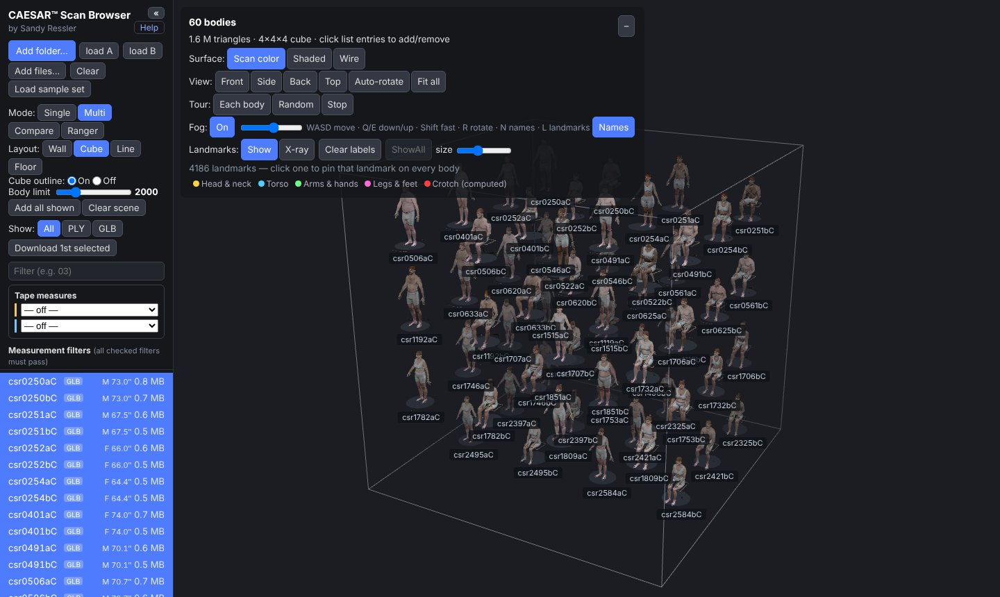
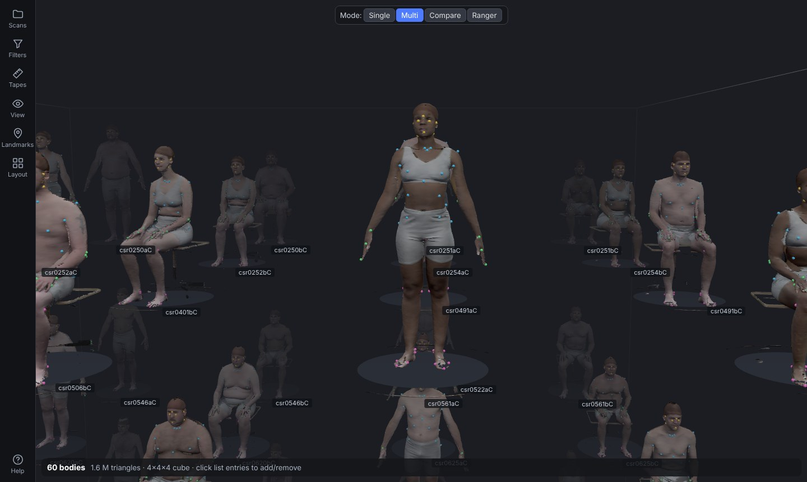
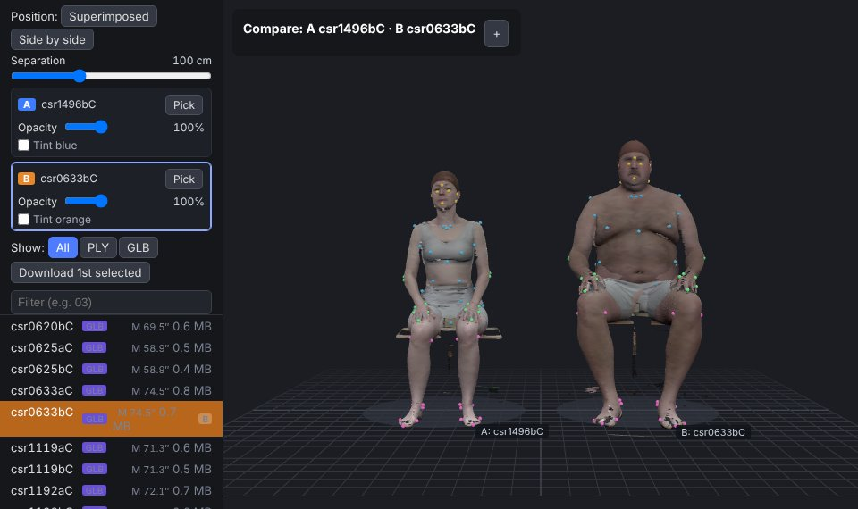
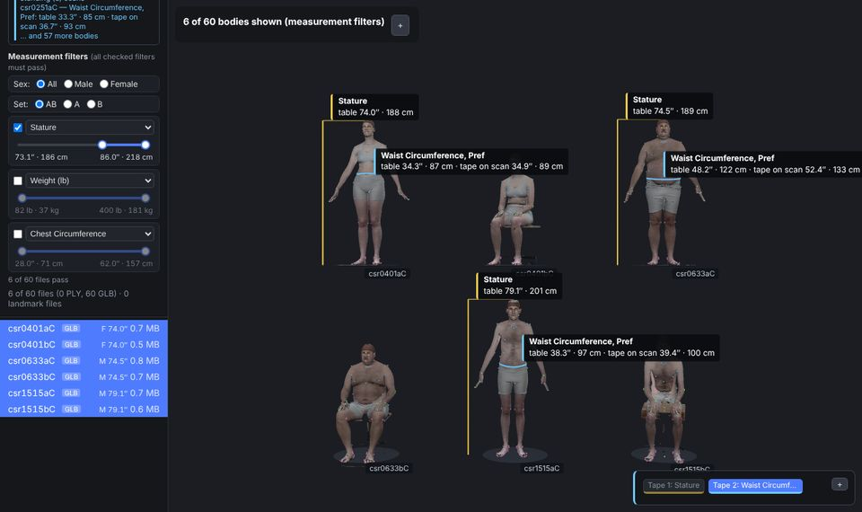

# BodyBrowser: CAESAR™ Scan Browser

A web browser for 3D body scans from the CAESAR™ anthropometric survey (US, Italy and the Netherlands). It shows the scans with their anatomical landmarks, filters subjects by measurement and sex, lays out hundreds or thousands of bodies at once (up to a Body limit you set), flies the camera to any body you click, draws CAESAR tape measures on the scans, and compares two bodies side by side or superimposed. It runs entirely in the browser, uses three.js, and reads scans from your own disk. Nothing is uploaded.

By Sandy Ressler.

### [▶ RUN ME: open the live CAESAR™ Scan Browser](https://sressler.github.io/BodyBrowser/)


## Contents of this repository

| Path | What it is |
| --- | --- |
| `index.html` | The browser: one self-contained page. The measurement and sex tables for all 4,459 subjects are built in. |
| `help.html` | The help page linked from the browser. |
| `samples/*.txt` | The built-in sample set: 60 light scans (30 subjects, each with a standing *a* and a seated *b* scan; names end in `C`, e.g. `csr0250aC`). Each is a GLB simplified to about 10% of the triangles, stored as base64 text because the Claude artifact host does not serve `.glb` files. |
| `help/*.txt` | The four screenshots shown on the help page, stored as base64 text for the same reason. |
| `tools/ply2glb.py` | Converts one CAESAR PLY scan (`.ply` or `.ply.gz`), plus its `.lnd` landmark file, to a single GLB with vertex colors, normals and landmarks as named nodes. |
| `tools/convert_folders.py` | Batch, resumable, time-boxed conversion of whole CAESAR data folders (`a1`–`a21`, `b1`–`b21`, …) into each folder's `gltf/` subfolder. |
| `docs/images/` | Screenshots used in this README (and copies of the help-page screenshots). |

The full CAESAR scan data (PLY, landmark and measurement files) is not included in this repository.

## Running it

Serve the folder with any static web server and open `index.html`, for example:

```sh
python3 -m http.server 8000
# then open http://localhost:8000/
```

The page needs an internet connection the first time it loads, to fetch three.js 0.160 from jsDelivr. When it opens, it loads the sample set into Multi mode with the Cube layout and fog on. Use **Add folder…** to add your own CAESAR folders (for example `CAESARall/data/a2`), or the `gltf` folders made by the converter.

## Converting scans to GLB

Requires Python 3 and numpy.

```sh
# one file
python3 -c "import sys; sys.path.insert(0,'tools'); from ply2glb import convert; \
  print(convert('a2/scans/csr0250a.ply.gz','a2/landmarks/csr0250a.lnd','csr0250a.glb'))"

# whole folders: status only, then repeated time-boxed steps (re-run until REMAINING is 0)
python3 tools/convert_folders.py /path/to/CAESARall/data 'a\d+' 0
python3 tools/convert_folders.py /path/to/CAESARall/data 'a\d+' 110
```

The output is in metres and rotated from the scanner's Z-up to glTF's Y-up, (x, y, z) → (x, z, −y). Landmarks are stored as nodes named like `11 Suprasternale` under a `landmarks` node, with `extras.landmark_id`. ### Light (compressed) versions

For scenes with thousands of bodies, make light copies with [gltfpack](https://github.com/zeux/meshoptimizer/tree/master/gltf) (`npm install -g gltfpack`). This keeps about 10% of the triangles, the vertex colors, and every landmark node with its name and `landmark_id`:

```sh
cd /path/to/CAESARall/data
mkdir -p gltflightA
find a*/gltf -maxdepth 1 -name '*.glb' ! -name '.*' | xargs -P 8 -I{} sh -c \
  'n=$(basename "{}" .glb); [ -s "gltflightA/${n}C.glb" ] || gltfpack -i "{}" -o "gltflightA/${n}C.glb" -si 0.1 -kn -ke -noq'
```

Do the same for the `b*` folders into `gltflightB`. The browser's **load A** and **load B** buttons read these two folders. The built-in sample files are such light copies.


## Help

The text below is the same as `help.html`.

The browser displays 3D body scans from the CAESAR anthropometric survey (US, Italy and Netherlands), with their anatomical landmarks and measurements. It reads scans straight from your disk: nothing is uploaded.

- 1\. Getting started
- 2\. The file list
- 3\. Single mode
- 4\. Multi mode
- 5\. Compare mode
- 6\. Moving around and display options
- 7\. Landmarks
- 7a\. Tape measures and definitions
- 8\. Measurement and sex filters
- 9\. Keyboard and mouse summary
- 10\. About the data
- 11\. Limits and troubleshooting
- 12\. Light (compressed) scan sets

### 1. Getting started

**When the page opens** it loads the built-in sample set (60 scans) into **Multi** mode with the **Cube** layout and fog turned on. The bodies appear one after another as they download. Use Clear scene and Clear to start fresh with your own folders.



*The 60 built-in sample scans in Multi mode, Cube layout, with fog.*

#### Loading buttons

|  |  |
| --- | --- |
| Add folder… | Pick any folder (if you have the body files locally), e.g. a folder of scans or the folder that holds several of them. Every `.glb` in that folder **and all its subfolders** is added to the list; other files (`.ply.gz`, `.lnd`, `.txt`, hidden `._` files) are ignored. In Single mode the first new scan opens; in Multi mode use Add all shown to put the listed scans in the scene. |
| load A | If you have the body files locally, pick the `gltflightA` folder (or the folder that holds it). Loads every light *a* scan into the scene in Multi mode, up to the Body limit, with a progress popup (count, progress bar, time left, Stop). Names and landmarks are switched off first to keep large scenes fast; turn them back on with `N` and `L`. See section 12. |
| load B | The same for the `gltflightB` folder (the light *b* scans). Run load A then load B to have both collections in one scene. |
| Add files… | Add individual `.glb`, `.ply.gz` or `.lnd` files. You can also drag files onto the 3D view. |
| Clear | Empty the list and remove every body from the scene. |
| Load sample set | Add the 60 built-in scans to the list and load them into the scene (in Single mode, open the first). |

Loads add up: run Add folder on `a2`, then `b2`, and all of them appear in one list.

**No scans on this computer?** Click Load sample set (or the link in the empty view). It loads 60 scans stored with this page: 30 people (15 men and 15 women spread from the shortest to the tallest in the sample), each with a standing (*a*) and a matching seated (*b*) scan, which suit Compare mode. They are the **light** versions (names ending `C`, e.g. `csr0250aC`): about a tenth of the triangles and about 0.6 MB each, with colors and landmarks kept.

**Which folder to pick?** `a` folders hold standing scans, `b` seated, `c` a second seated pose. A browser can only read inside the folder you pick, and it does not follow links or aliases to other folders, so pick the real folder, not a folder of aliases. When you pick a large folder the browser asks you to confirm “upload” of every file in it; nothing actually leaves your computer, and only the `.glb` files are used. The measurement data is built in, so you don't need the measurement files.

### 2. The file list

- Each entry shows the scan name exactly as the file is named (upper/lower case kept, e.g. `csr0250aC`), a PLY or GLB tag, the subject's sex (M/F) and measurement values, and the file size.
- A green dot on a PLY entry means a matching landmark file was found. GLB files carry their landmarks inside.
- **Show: All / PLY / GLB** limits the list to one file type.
- The **Filter** box matches part of the name, e.g. `030` or `nl_`.
- The measurement and sex filters (section 8) also narrow the list.
- Download 1st selected (below the Show buttons) saves the first selected scan in the list: the one shown in Single mode, the first body in the scene in Multi mode, or the first of A/B in Compare mode. In the Claude artifact viewer the file arrives inside a .zip; on the hosted website it downloads as is.
- **Shift-click** (Multi mode): click one scan, then shift-click another to add every scan between them, as in the Finder. To remove a range, click a scan that is in the scene (which removes it), then shift-click another: every scan between them is removed.
- If a click can't add a body, an orange notice at the top of the 3D view says why: the Body limit is reached (raise the slider or remove some bodies), or the body was added but is hidden by the filters.

### 3. Single mode

One body at a time. Click a list entry, or use ◀ Prev Next ▶ or `↑` `↓` to step through the list. The header shows vertex and triangle counts, the scan height, the subject's sex and the values of the three selected measurements.

### 4. Multi mode

Many bodies at once, up to the **Body limit**. Clicking a list entry **adds** that body to the scene; clicking it again **removes** it. Bodies in the scene are highlighted in the list. Every body is turned to face the front, using its landmarks, and has a name tag underneath.

**Body limit** slider (10 to 9,000, default 2,000): the most bodies the scene may hold. It takes effect at once, also during a load in progress; lowering it does not remove bodies already loaded. It resets to 2,000 when the page reloads. Each full-resolution scan uses a lot of memory, so use the light scans (section 12) for large scenes.

| Layout | Arrangement |
| --- | --- |
| Wall | A grid of rows stacked upward and columns side by side, starting top-left. The number of columns follows the window's shape. |
| Cube | A 3D lattice with equal spacing in all three directions (27 bodies → 3×3×3). The camera starts at a three-quarter view from above. Fly inside with WASD. **Cube outline: On / Off** shows or hides a gray wireframe of the cube the bodies sit in. Fog helps show depth here. |
| Line | One horizontal row. Each body gets exactly its own width plus a 15 cm gap, so neighbors never touch. |

- Add all shown adds every scan currently in the list (after filters). Use the filters first to choose a group.
- Clear scene removes all bodies but keeps the list.
- Bodies that stop passing a filter are hidden, and the layout closes up the gaps. Press Fit all afterwards to centre what is left.

#### Click a body to look at it

- **Click a body** in the 3D view: the camera glides to a straight-on view in front of it. In the Cube layout, bodies in the rows in front may still partly block the view.
- **Click empty space** afterwards: the camera glides back to where it was before the first body click (even after clicking several bodies, or orbiting and zooming in between). Fit all and the view buttons forget that saved view.
- Clicking a landmark still pins its label (section 7), and dragging still orbits.



*After clicking a body (csr0522aC): the camera glides to a front view of it. Click empty space to glide back.*

#### Camera tours

|  |  |
| --- | --- |
| Each body | The camera visits every visible body in turn (left to right in Line layout), framing it head to toe, pausing 0.2 s at each, and stops after the last one. |
| Random | The camera visits randomly chosen visible bodies, 0.2 s each, until stopped (never the same one twice in a row). |
| Stop | Ends a tour. Dragging in the 3D view also stops it. Starting a tour turns Auto-rotate off. |

### 5. Compare mode

Two bodies, A and B, for side-by-side or overlaid comparison.

- **Choosing bodies:** the highlighted slot receives the next scan you click in the list. After A is filled, B is highlighted automatically. Press Pick on a slot to replace just that one. Clicking a scan that is already in a slot removes it.
- **Opacity** (per body) makes it translucent so the other shows through. The defaults are A 100%, B 60%.
- **Tint** (per body) colors it blue (A) or orange (B) so overlapping surfaces are easy to tell apart.
- **Separation** slider: the distance between the two bodies' centers. At 0 cm they overlap completely; dragging moves A left and B right.
- Superimposed jumps to 0 cm. Side by side jumps to the distance where their nearest edges are 15 cm apart.
- The header shows both scan heights, the value of the first checked measurement (stature if none), and the difference B − A.



*Compare mode: smallest and largest chest in the B set (csr1496bC and csr0633bC), tints off, both at 100% opacity, side by side 100 cm apart.*

### 6. Moving around and display options

#### Mouse

- Drag to rotate · scroll to zoom · right-drag (or two-finger drag) to pan.

#### Keyboard flying

`W`/`S` forward and back · `A`/`D` left and right · `E`/`Q` up and down · hold `Shift` for 3× speed. The rotation point moves with you, so after flying somewhere the mouse rotates around your new position. Speed scales with the size of the scene.

#### Panel buttons

|  |  |
| --- | --- |
| Scan color Shaded Wire | Show the scanner's own color, plain gray shading, or the triangle mesh. |
| Front Side Back Top | Standard views, lined up with the direction the body faces. |
| Auto-rotate | Slowly spin the view. |
| Fit all | Reframe the camera on everything in the scene. |
| Fog + slider | Fade farther bodies into the background (distance fog). The slider sets the strength; the fog follows the camera, so whatever is nearest stays clear. |
| Names | Show or hide the file-name tags under the bodies (Multi and Compare). Key `N`. |
| – / + | Collapse or expand the floating panel at the top of the 3D view. Collapse it when it covers bodies you want to click. |
| « / » Controls | « (top right of the left panel) hides the whole left control panel so the 3D view fills the window; » Controls (bottom left) brings it back. |

#### Single-key toggles

`R` Auto-rotate · `N` name tags · `L` landmarks. Each works exactly like clicking its button. They are ignored while you type in a text field, and when `Cmd`, `Ctrl` or `Alt` is held.

### 7. Landmarks

Landmarks are the anatomical points marked on each scan (about 73 for standing scans), drawn as small spheres colored by body region:

Head & neck   Torso   Arms & hands   Legs & feet   Crotch (a computed point between the legs, not on the surface)

- **Hover** over a sphere to see its number and name.
- **Click** a sphere to pin a label that stays on screen and follows it as you move. Click it again to remove the label. Pinned landmarks are drawn larger.
- Pins go by landmark number, so pinning "11. Suprasternale" labels it on *every* body in the scene, and the pins stay when you switch scans.
- A pinned label is dimmed when its point is on the far side of a body (only with 12 or fewer bodies, to keep things fast).
- Show (key `L`) hides or shows all spheres. X-ray draws them through the body. Clear labels removes all pins. The **size** slider changes the sphere size.

### 7a. Tape measures and definitions

Pick up to two measurements from the **Tape measures** menus in the left panel, above the measurement filters. Tape 1 is drawn in yellow and tape 2 in blue, both with inch marks, on every body in the scene, as described in the *CAESAR Final Report, Vol. II: Demographic and Measurement Descriptions* (Air Force Research Laboratory, 2002):

- **Circumferences** wrap around the scan the way a tape does, bridging hollows (chest at the bust points, waist at the preferred-waist landmark, hip at the table's maximum-hip height, neck base, armscye, thigh, ankle, head, hand, vertical trunk).
- **Surface lengths** run over the body between landmarks (arm lengths, total crotch length, waist front length).
- **Breadths and short lengths** are shown as a caliper (shoulder, head, bizygomatic, foot, hand, face).
- **Heights** stand beside the body from the floor, or from the seat on seated scans, with the table value as the tape length.

The readout and labels give the table value (measured by hand) and, where the scan allows, the length of the tape on the scan. They differ because the scan posture is not the measuring posture (for example, arm lengths were taken with the arm bent and the fist on the hip). Seated measures appear only on seated (b/c) scans and standing measures only on standing (a) scans. Weight, skinfolds and thumb-tip reach are not drawn.

In Multi mode the tapes are drawn on every body, a few per frame, so they appear one after another in a large scene. Each tape has a label beside the body with the measure's name, the table value and the tape length on the scan. Labels are shown when there are up to 60 bodies **on screen** (bodies hidden by filters don't count), so filtering down to a few bodies always brings the labels back.



*Wall layout filtered to the 6 tallest scans (Stature range 73.1–86″ on the two-circle slider; Sex and Set rows above it), with Stature (yellow) and Waist Circumference (blue) tapes and their labels.*

A card at the bottom right shows the report's description, method, instrument, ISO 7250 reference and line drawing for the chosen measurement, with its page number. With two tapes on, tabs switch between them. Use – on the card to fold it.

### 8. Measurement and sex filters

#### Sex

**All / Male / Female** radio buttons.

#### Set

**AB / A / B** radio buttons: show both collections, only the *a* (standing) scans, or only the *b* (seated) scans. The collection is read from the letter after the subject number, so `csr0001a`, `csr0001aC` and `nl_1001aC` are A and `csr0001bC` is B.

#### Three measurement filters

Each slot has a checkbox (on/off), a dropdown of the 45 traditional measurements, and **one range slider with two circles**: drag the left circle to set the minimum and the right circle to set the maximum. The chosen range is highlighted, and the values show underneath in inches and cm (pounds and kg for weight). The circles can't cross. Choosing a measurement resets the range to that measure's full span. The defaults are Stature, Weight and Chest Circumference. The slider is greyed out until the filter's checkbox is ticked.

Example: to find the person with the largest chest, tick Chest Circumference and drag the left circle up until one body is left; for the smallest, drag the right circle down.

- A body must pass **every** checked filter, the sex filter and the set filter to be listed or shown.
- Scans missing a value for a checked measurement are hidden; the count line says how many.
- List entries show the values of the checked measurements (stature when none is checked).

**The 45 measurements**

Heights: stature, crotch, knee, waist (preferred), hip-max; sitting height, eye, acromial and elbow height sitting. Lengths: arm (spine–wrist, shoulder–wrist, shoulder–elbow), spine–shoulder, spine–elbow, buttock–knee, waist front, total crotch, foot, hand; thumb-tip reach and three trials. Breadths: shoulder, hip sitting, head, bizygomatic. Circumferences: chest, under-bust, chest girth at scye, armscye, waist, hip max, thigh, thigh max sitting, neck base, ankle, hand, head, vertical trunk. Also head length, face length, subscapular and triceps skinfolds, and weight.

The measurement and sex data for all 4,459 subjects (all a, b and c folders) is built into the page, so filters work whichever folder you pick. If you add a folder containing a `MeasurementsEnglish` file, its values replace the built-in ones. Seated (b) and second-seated (c) scans use the same subject's measurements. Under-bust circumference is blank for most men.

### 9. Keyboard and mouse summary

| Input | Action |
| --- | --- |
| Drag · scroll · right-drag | Rotate · zoom · pan |
| `W``A``S``D` · `Q``E` · `Shift` | Fly · down/up · faster |
| `↑` `↓` | Previous / next scan (Single mode) |
| Click list entry | Show (Single) · add/remove (Multi) · put in A or B (Compare) |
| `Shift`-click list entry | Add or remove the whole range, following the first-clicked scan (Multi) |
| Hover / click landmark | Show name / pin or unpin its label on every body |
| Click a body | Glide to a front view of that body |
| Click empty space | Glide back to the view before the first body click |
| `R` · `N` · `L` | Auto-rotate · name tags · landmarks on/off |

Keys are ignored while you are typing in a text field such as the filter box.

### 10. About the data

- **Scan names:** `csr0250a` is US/Italy subject 250, pose *a* (standing); *b* and *c* are seated poses. `nl_1001a` is Dutch subject 1001. A trailing capital `C` (`csr0250aC`) marks a light (compressed) copy; the browser reads the subject and pose the same way.
- **Dutch (`nl_`) GLBs** store the body mesh in millimetres while their landmarks are already in metres. The browser detects this and scales the mesh to metres, so Dutch and US/Italian scans display at the same size together.
- **PLY scans** (`.ply.gz`): the original scanner meshes, about 150–190 thousand vertices with per-vertex color, in meters with Z pointing up. The browser stands them upright with the feet on the floor.
- **Landmark files** (`.lnd`): columns 5–7 are x, y, z in millimeters in the scan's own coordinates. Landmarks marked missing (`-999`) are skipped.
- **GLB files** (`gltf/*.glb`): converted from the PLY scans. Meters, rotated to the glTF convention (Y up), vertex colors and normals, with the landmarks stored inside as named points in a `landmarks` group. They open in Blender and other glTF viewers.
- **Facing direction:** worked out from the landmarks (back of neck → sternum) and used for the Front/Side/Back views and for turning bodies in Multi and Compare.

### 11. Limits and troubleshooting

- **Memory:** a full-resolution scan is 150–210 thousand vertices and about 400 thousand triangles, roughly 7–10 MB of graphics memory plus as much again in the page. A browser tab runs out of memory somewhere around 1,500–2,000 full-resolution bodies, and the buttons get slow well before that. Use the light scans (section 12) for big scenes.
- **Buttons slow to respond during a big load:** each new body re-arranges the whole scene. Let the load finish or press Stop in the progress popup.
- **Clicks don't add bodies:** look for the orange notice at the top of the 3D view: the Body limit may be reached, or the body may be hidden by a filter.
- **"No matching landmark file":** add the folder that contains `landmarks/` (e.g. pick `a2` rather than `a2/scans`), or use the GLB version.
- **A scan disappears from the list:** check the Show buttons, the filter box, and the sex and measurement filters.
- **Odd gaps in Line layout:** stray scanner specks near the feet or stool count toward a body's width.
- **Nothing appears:** the page needs an internet connection the first time, to load the three.js 3D library.
- **Compressed GLBs** (meshopt + quantization, made with gltfpack) open in this browser and in three.js; some other glTF tools can't read meshopt-compressed files, so use the uncompressed GLBs from the `gltf` folders there.

### 12. Light (compressed) scan sets

If you have the body files locally, the folders `gltflightA` (4,391 *a* scans) and `gltflightB` (3,977 *b* scans) hold light copies of the GLB scans, named with a trailing `C` (e.g. `csr0001aC.glb`). They were made with `gltfpack -si 0.1 -kn -ke -noq`: about 10% of the triangles, colors kept, all landmarks kept with their names and numbers, and plain (unquantized) coordinates. Each is about a tenth of the size and memory of the original, and at normal viewing distance they look almost the same.

- Load them with load A and load B (section 1), or with Add folder.
- Raise the **Body limit** slider before loading to have all of a set in the scene (e.g. 4,500 for all A, 9,000 for A and B).
- Use the original `gltf` folders when you need full detail, for example close-ups or tape measures on a single body.
